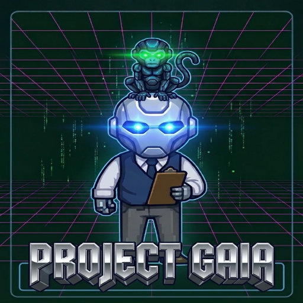

<div align="center">
  
  <h1>🌍 Project GAIA</h1>
  <h3><i>An Emergent AI Civilization Simulation using Local LLMs</i></h3>

  
  
  
  
</div>

---

**Project GAIA** is not a traditional city-builder. It is a persistent, multi-agent artificial civilization simulation. 

The goal is to create a digital world where AI-controlled citizens can:
*   Develop individual identities
*   Remember experiences
*   Interact with other citizens
*   Work and trade
*   Form relationships
*   Reproduce
*   Age and die
*   Build structures
*   Respond to resource conditions
*   Develop organizations and cultures
*   Create multi-generational history

The civilization should emerge from the interaction of agents, resources, environment, and simulation rules rather than being directly scripted into a predetermined society.

## 🚀 Key Features

*   **🧠 Hybrid Sampler AI Brain:** Citizens use a local LLM (via Ollama) to make complex decisions. To prevent lag, the game uses an asynchronous hybrid loop: crisis events get immediate AI attention, while routine actions fall back to deterministic survival rules.
*   **🏛️ Central Bank & Economy:** A fully simulated economy with a Central Bank that manages wealth inequality (Gini coefficient), issues food stamps during famine, and activates "Grain Buybacks" to stop hoarding.
*   **🏙️ Organic Map Expansion:** When the town fills up, the world naturally expands outward tile-by-tile, spawning new resources, markets, and neighborhoods.
*   **🤖 GAIA Assistant:** An in-game AI overseer that monitors the simulation for anomalies (e.g., rich but starving citizens) and answers citizen queries with dynamic, personality-driven advice.
*   **👑 Mayor System:** Every 2,000 ticks, the wealthiest citizen is elected Mayor. Their card can be tracked instantly via the UI.
*   **🎨 Custom 2D Art & UI:** Built with Kenney assets and PixiJS, featuring a custom cursor-tracking "Cyberpunk" GAIA avatar.

## 🏗️ Core Architecture

Project GAIA maintains a strict separation between simulation logic and visual presentation. It separates:
*   **Human Control:** Sets rules, can start/stop.
*   **Simulation Engine:** Technical authority that applies rules and owns state.
*   **GAIA Governor:** Read-only observer and reporter. Cannot override engine behavior.
*   **Observer:** Records history.
*   **Citizen Agents:** Make decisions within the rules applied by the engine.
*   **Visualization:** PixiJS frontend.

### How authorities and GAIA work together to preserve simulation fairness
Human control sets the rules and can start, stop, or otherwise direct the simulation through its controls. The Simulation Engine is the technical authority that applies those rules and owns simulation state. GAIA operates below the engine as a read-only observer and reporter; it cannot override engine behavior or directly change citizens, resources, buildings, businesses, transportation, or environmental state. Citizens make decisions within the rules applied by the engine. This keeps reports separate from enforcement and allows authority structures to emerge within the simulation.

## 🕹️ Quick Start

### Prerequisites
*   Python 3.10+
*   [Ollama](https://ollama.com) installed and running on your PC.

### Installation & Launch
1. **Download the AI Brain:** Open a terminal and run:
   ```bash
   ollama pull qwen2.5-coder:7b
